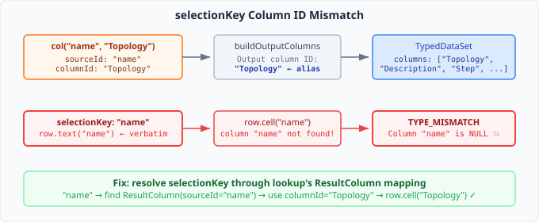
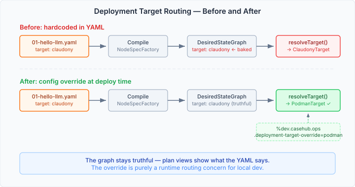
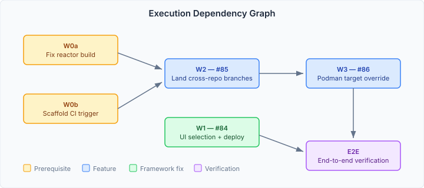

# Five Problems Behind One Deploy Button

The previous entry built the topology catalogue — a compile-plan-deploy pipeline that turns YAML topology definitions into a desired-state graph, plans the transitions, and hands them to a reconciliation loop. The Deploy tab showed a table of topologies with their metadata. What it didn't do: let you click one and actually deploy it.

That's what this epic is about. Select a topology row, click Deploy, watch four Podman containers come up in dependency order. One button, end-to-end. The kind of feature that sounds like a day's wiring work until you look at what's actually standing between you and a working deploy.

## The column alias trap

The first thing I wanted was row selection on the catalogue table. The pages-ui DSL has `selection: "single"` and `selectionKey` — point it at a column and the table tracks which row is selected. Straightforward.

```typescript
dataTable({
  lookup: lookup("catalogue", groupBy(null,
    col("name", "Topology"),
    col("description", "Description"),
  )),
  selection: "single",
  selectionKey: "name",
})
```

It crashed immediately: `TYPE_MISMATCH: Column "name" is NULL, not TEXT or LABEL`.

Claude and I traced it through three layers of the pages framework. The issue is a column ID mismatch hidden by an abstraction boundary. `col("name", "Topology")` creates a `ResultColumn` with `sourceId: "name"` and `columnId: "Topology"`. When `buildOutputColumns` in the data pipeline constructs the output dataset, it uses `columnId` — the alias — as the column's identity. But `selectionKey: "name"` gets passed verbatim to `row.text("name")` in the activation layer, which looks for a column called `"name"` in the output. There is no such column. The output has `"Topology"`.



The fix belongs in `activation.ts`, where the selection wiring happens. When `selectionKey` is set, resolve it through the lookup's `ResultColumn` mapping — if `"name"` matches a `sourceId`, use the corresponding `columnId` instead. And switch from `row.text()` (which throws on non-TEXT types) to `row.cell()` with string coercion. Users write `col("name", "Topology")` and expect `selectionKey: "name"` to just work. The framework should close that gap.

## Where do topologies actually deploy?

The Level 01 topology (`01-hello-llm.yaml`) defines four nodes — manifest, eidos, engine, my-llm — in a linear dependency chain. Every one of them hardcodes `deploymentTarget: claudony`. Claudony is the production fleet manager. I need these containers running locally in Podman.

I had three options for overriding the target: change the YAML, make the YAML target-agnostic, or override at runtime. I chose runtime override. The reasoning: the desired-state graph should represent what the YAML says. Plan views, diagnostics, and auditing all benefit from the graph being truthful about the declaration. The runtime environment determines where things actually deploy.



The injection point is `CaseHubAppProvisionHandler.resolveTarget()`. It takes a target ID string, iterates all CDI-registered `ApplicationDeploymentTarget` beans, and matches by `targetId()`. Adding a `casehub.ops.deployment-target-override` config property — when set, it replaces the per-node target before the iteration — keeps the mechanism clean. The same override goes into `CaseHubAppDriftChecker.resolveTarget()` so drift detection stays in sync. Scaffold sets `%dev.casehub.ops.deployment-target-override=podman` and `PodmanDeploymentTarget` (already `@ApplicationScoped`, already returns `targetId() == "podman"`) handles the rest.

One catch: scaffold's `pom.xml` depends on `casehub-ops-service` but not `casehub-ops-container`. Without the container module on the classpath, `PodmanDeploymentTarget` isn't CDI-discoverable. A missing dependency masquerading as a missing feature.

## The CI problems nobody asked about

I didn't set out to fix CI. I was checking whether the cross-repo branches from the previous epic (engine's `@ApplicationScoped` fix, ops' `compileTopology()` extraction) were safe to merge. That's when I noticed the casehub-all reactor was red. Every recent build — all of them.

The error: `Jandex index not found at registry-jpa/target/classes/META-INF/jandex.idx. Build the Quarkus module first.` The platform builds in parallel slices. Slice B builds `registry-jpa` and uploads its Jandex index as a CI artifact. The convergence phase downloads all artifacts and runs the full reactor with `-T 1C`. But the convergence aggregator (`aggregator-convergence.xml`) is designed to list Quarkus modules as Jandex fallbacks for when downloads fail — and `registry-jpa` isn't in that list. Neither are seven other paired modules. When the artifact download is corrupt or missing, there's no fallback, and `registry-spring-jpa`'s source generator crashes at `generate-sources` phase.

Then there was scaffold's own CI. The `Build and Publish` workflow triggers on `repository_dispatch`, `pull_request`, and `workflow_dispatch`. Not on `push`. The four commits from the previous epic were pushed directly to main. The workflow never fired. Scaffold has been running untested on CI since those commits landed.

Two CI problems, neither related to the deploy feature, both blocking safe validation of the work. They go into the plan as prerequisites.

## The image question

The four container images for Level 01 — `casehubio/manifest`, `casehubio/eidos`, `casehubio/engine`, `casehubio/my-llm-app` — don't exist in any registry. Ops operates on a prebuilt-image model: `PrebuiltImagePipeline` is the default `ApplicationBuildPipeline`, and it just passes through the `image` field from the topology YAML. No building happens. The `topology-test-on-dispatch.yml` workflow gets triggered by `image-pushed` events from upstream repos — ops consumes images, it doesn't produce them.

For local dev, the images need to come from somewhere. Each source repo will need a Quarkus `container-image-podman` extension in a Maven profile — `mvn package -Pcontainer -DskipTests` builds the image into the local Podman store. This is prerequisite work in each source repo, outside the scope of scaffold.

## Five batches

What started as "wire a deploy button" became five workstreams across four repositories.



The prerequisite fixes (reactor build order, scaffold CI trigger) can run in parallel. The UI work (selectionKey fix + deploy button wiring) and branch landing can run in parallel after the prerequisites. The Podman target override needs the branches landed. End-to-end verification needs everything. Eight tasks, five batches, each batch a safe wrap point.

The implementation plan is written but not started. The next session picks it up from Batch 1.
